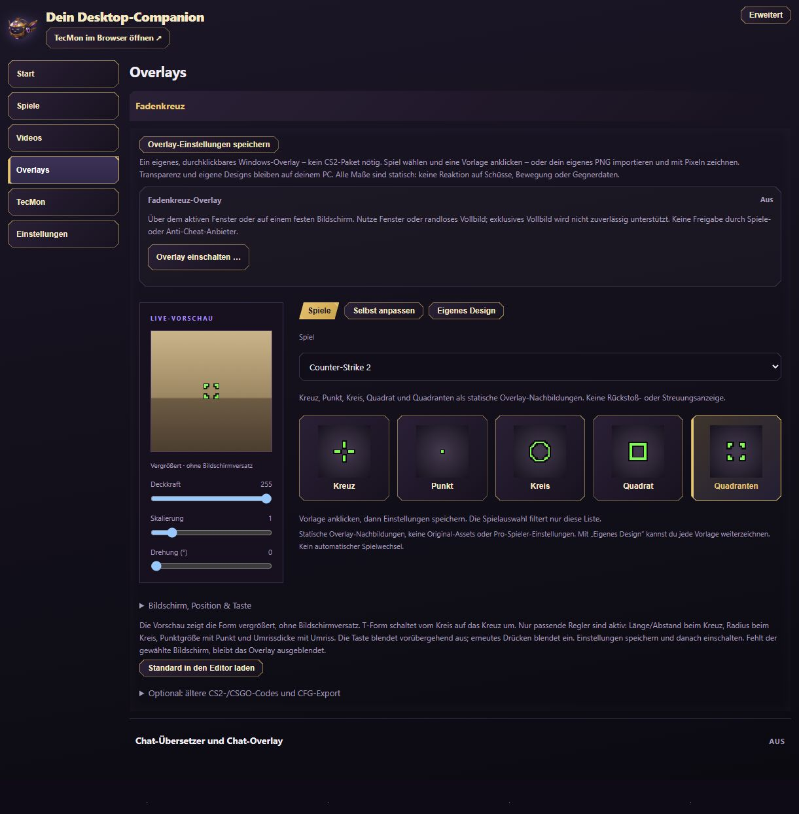
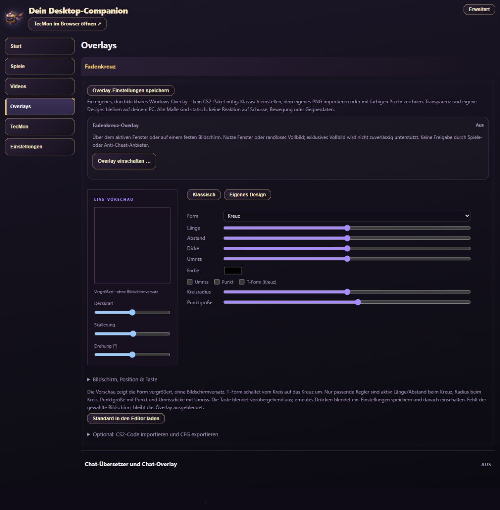

# Fadenkreuz-Studio, Popup und Sprechblase · 28. November 2026

Stand: lokal für 0.54.0 implementiert, noch nicht veröffentlicht oder installiert.

## Fadenkreuz

Overlays → Fadenkreuz öffnet zuerst „Spiele“. Spiel wählen, eine der maximal fünf
Vorlagen anklicken und speichern. Die Spielauswahl allein ändert kein Design.
22 eigene statische Vorlagen für sieben Shooter; alle zwölf Plattformspiele plus
Wardogs sind auswählbar. Die sechs anderen Spiele zeigen ehrlich einen Hinweis,
dass keine Vorlage hinterlegt ist. Kein automatischer Prozess- oder Waffenwechsel.
„Selbst anpassen“ enthält die bisherigen Regler, „Eigenes Design“ PNG und Pixel.
Das lokale Speichern oben übernimmt beide Erscheinungsbilder und die Bildschirmoptionen.
Ein importiertes PNG wird direkt im Pixel-Editor weiterbearbeitet. Wechsel zu „Selbst anpassen“
erhält den eigenen Entwurf; ein Standard-Reset ersetzt ihn bewusst erst im Editor.

Pixel-Editor: 16/32/64er Raster, auch rechteckige PNGs; Stift, Radierer, Pipette,
RGBA-Farbe, horizontale/vertikale Spiegelung und 40 Schritte Verlauf. Ein schneller
Zeichenstrich füllt Zwischenpunkte. Anpassen des Rasters erhält Pixel mittig und kann
rückgängig gemacht werden. Export schreibt ein transparentes PNG in Original-Pixelgröße.
Die goldenen Hilfslinien und das Schachbrett werden nicht mit exportiert.

Tastatur im Raster: Pfeile bewegen die Auswahl, Leertaste malt, Entf/Rücktaste radiert,
Strg+Z macht rückgängig, Strg+Umschalt+Z wiederholt. Rechtsklick radiert.
Die Pixel-Deckkraft gilt für neue Striche; die gemeinsame Deckkraft für das gesamte Overlay.

Maximal 2 MB und 512 Pixel je PNG-Seite, vor dem Decoder am Header geprüft.
Große Bilder werden proportional auf höchstens 64 Pixel je Seite verkleinert,
keine Ausschnitte abgeschnitten. Sichtbar im Importstatus. Leere Designs können nicht
als aktives Overlay gespeichert werden. RGBA-Pixel werden serverseitig erneut validiert;
keine Datei wird an einen Internetdienst geschickt. Native Anzeige benötigt keinen
Bild-Decoder und akzeptiert keine Dateipfade. Maximale native Bildausdehnung 352 px,
damit gedrehte Designs bei hoher DPI nicht am Overlayfenster abgeschnitten werden.
Die Browser-Vorschau passt ihre Vergrößerung an den verfügbaren Platz an.

## Menü und eigene Sprechblase

Das Popup hat weiterhin sechs Bereiche und kompakte/große Ansicht. Es öffnet nahe der
Figur, ist anschließend unabhängig verschiebbar und hat keine Sprechblasen-Spitze.
Beim Ziehen folgt die Figur nicht. Maus- und Tray-Bedienung bleiben bestehen.

Einstellungen → Menü & Sprechblasen: keine Menütaste (Standard), eine Taste wie F8
oder eine Zusatztaste mit Taste, etwa Strg+M. Buchstaben, Ziffern, F1–F12 und einige
Navigationstasten stehen zur Wahl. Zwei gewöhnliche Buchstaben gleichzeitig sind
kein unterstützter Windows-Hotkey; die zweite Taste ist Strg, Alt, Umschalt oder Windows.
Einzeltasten sind für TecMon reserviert, solange sie eingerichtet sind. Konflikte und
reservierte Windows-Kombinationen werden angezeigt; Maus/Tray bleiben als Rückweg.
Kein Hook, kein Mitlesen anderer Tasten, keine synthetischen Spieleingaben.

Die neue Anzeigeort-Auswahl betrifft **TecMons eigene Tipps, Witze und Sprüche**:
neben Figur; nur CS2-Bildschirm (außerhalb CS2 neben Figur); oder Figur plus Kopie auf
einem anderen CS2-Bildschirm. Letzteres ist Standard. Gleicher Bildschirm erzeugt keine
Kopie. Das Menü verdrängt die eigene Sprechblase nicht mehr an einen anderen Ort.
Fokuswechsel können die zusätzliche Kopie ausblenden; bei Rückkehr erscheint dieselbe
noch aktive Meldung wieder. Beim Ende der Meldung verschwinden beide. GSI-quiet bleibt
wirksam. Übersetzter Spielerchat einschließlich seines Overlays bleibt separat wie bisher.

## Prüfung und Grenzen

- 252 Node-Tests erfolgreich, zwei bestehende Symlink-Tests übersprungen.
- API: eigenes Design speichern, aus `/api/state` lesen, Neustart; ungültige Daten
  ändern keine Teil-Einstellungen. Keine Spiel-cfg und kein CS2-Paket nötig.
- Browser: Zeichnen, Spiegeln, Speichern, erneutes Laden, PNG-Import und -Export.
  Exportierte RGBA-Bytes waren identisch zum synthetischen Import-PNG.
- Nativer Windows-Test: Transparenz und Halbtransparenz, Farben, 45°/hohe DPI;
  bestehende Kreuz-/T-/Kreis-, Fenster-, Filter- und Hotkey-Prüfungen.
- Eigener C#-5-Test: RegisterHotKey-Konflikt mit zweitem Testfenster, Popup durch
  eigene WM_HOTKEY-Nachricht öffnen/schließen, Popup verschieben ohne Figur,
  primäre Sprechblase plus Kopie, Fokuswechsel, gemeinsames Ausblenden/Dispose.
- Kein Spiel gestartet und keine Spiel-Eingaben simuliert. Der tatsächliche
  Zwei-Monitor-CS2-Durchlauf und Escape aus einer installierten WebView2-Instanz
  sind noch nicht interaktiv geprüft. Release und Installation sind separate Schritte.

## Recherche und Grenzen der Spielvorlagen

Stand 28.11.2026: Plattformkatalog `tecmon/core/games/types.ts` und Companion
`games.mjs` abgeglichen. Eigene rasterisierte Formen, keine Behauptung exakter
Originalwerte, Waffenstreuung, Pro-Settings oder dynamischer ADS-/Heldenwechsel.

- [Riot: Valorant 5.04](https://playvalorant.com/en-us/news/game-updates/valorant-patch-notes-5-04/):
  Farben und getrennte horizontale/vertikale Linien. Unsere Vorlagen sind statisch.
- [Valve: CS2 23.09.2026](https://www.counter-strike.net/newsentry/674006995886408819)
  und [30.09.2026](https://www.counter-strike.net/newsentry/675133527946166402):
  überarbeitetes Fadenkreuzsystem und Quadranten. Deshalb geometrische Overlay-Vorlagen;
  vorhandener CSGO-Decoder bleibt ausdrücklich als älteres Codeformat gekennzeichnet.
- [Epic: Reticle-Einstellung](https://www.epicgames.com/help/c-34254770/c-33726977/a11099998?lang=th):
  Fortnite verwaltet seine Zielmarke im Spiel. Companion zeichnet eigene statische
  Alternativen darüber, ohne Waffen- oder Trefferfeedback auszulesen.

Für Apex, Deadlock, Gears und Wardogs sind die Formen ausdrücklich neutrale eigene
Alternativen, keine verifizierten exakten Original-Repliken. Keine Vorlage für LoL,
Dota 2, WoW, Aion oder Path of Exile bedeutet nur, dass hier keine hinterlegt ist.
Deren eigene Cursor, Fähigkeiten und Zielmarkierungen bleiben unverändert.
